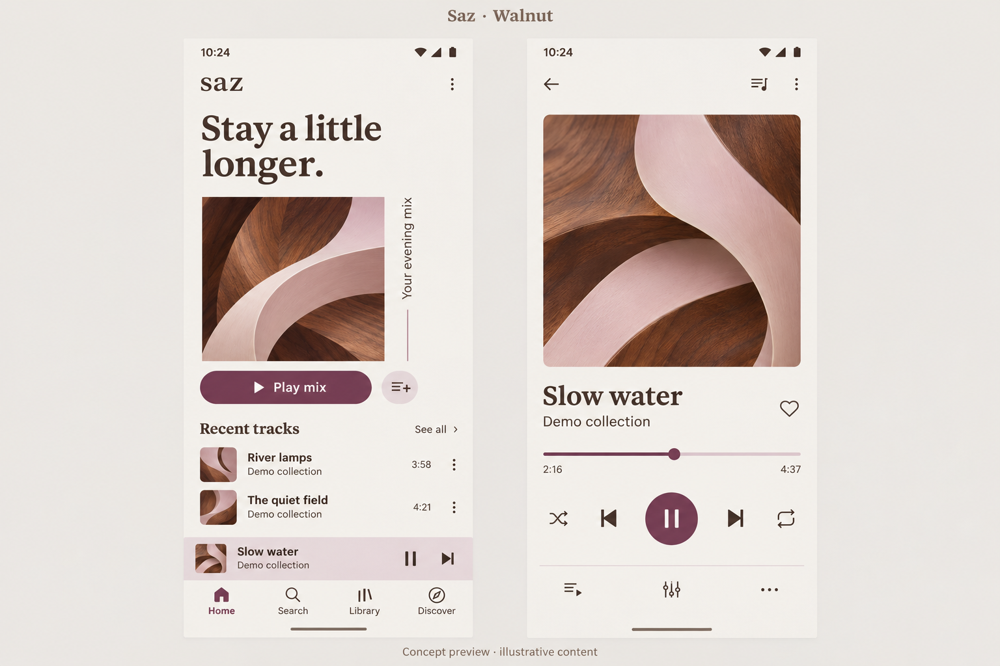
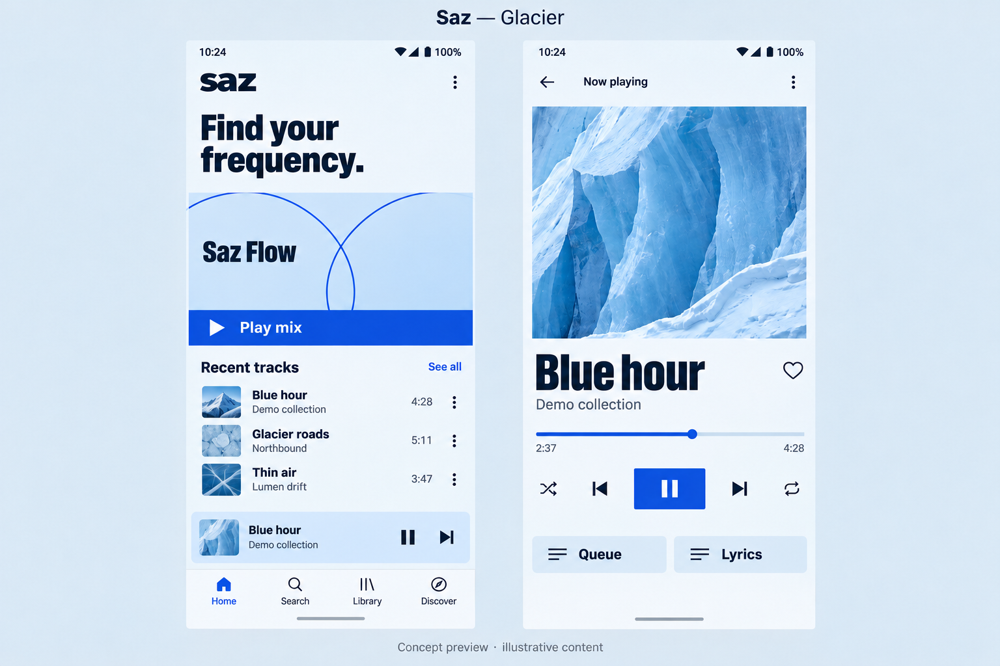
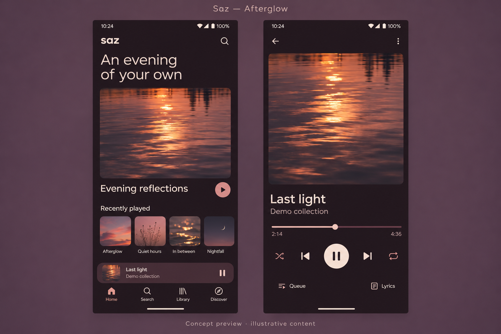

# Saz: three visual directions

15 November 2026. Proposals for approval, not implemented Android screens.
The PNGs are generated concept previews with fictional music and illustrative artwork.
They demonstrate composition and atmosphere; exact typography, icon semantics, contrast,
font licensing and dynamic layouts must be verified in Compose after selection.
Existing approved launcher art is not replaced by these proposed wordmarks.

## Findings from the current app

Reviewed `docs/screenshots/home.png`, the design/status documents, and `SazApp.kt`.
Scenery, luminous borders, Flow, mood tiles, mini-player and navigation compete for emphasis.
Repeated rounded glass surfaces give different actions similar weight. The persistent
bottom area occupies considerable screen space. Typography has limited differentiation.
Keep the working local library, Media3 controller, Room persistence and user-owned artwork.
The redesign should improve hierarchy rather than rewrite playback infrastructure.

Used installed UI/UX Pro Max and Frontend Design skills. The design-system search initially
suggested Apple-oriented liquid glass and web storytelling; rejected as a poor native fit.
A narrower search supplied useful minimal-layout guidance but generic blue/green branding;
the proposals below are independently art-directed. Compose-specific semantics and
UI-owned animation guidance apply. Imagegen supplied the visual mockups.

## Walnut — recommended

A personal listening journal, with subtly tactile artwork and confident literary typography.
The connection to Kashmir is material and craft, not applied ornament.

- Draft colors: mineral `#F0EEE8`, walnut ink `#352B28`, plum `#703D57`, pale mauve `#DFD0D7`, white `#FFFFFF`.
- Type proposal: Literata medium for restrained display/track titles; Source Sans 3 for controls and metadata. Fonts remain candidates pending license and script coverage checks.
- Composition: left-aligned editorial heading, asymmetrical feature artwork, compact recent-song rows and an integrated player strip. Album art becomes square and centered in the full player.
- Brand proposal: serif wordmark with deliberately tuned spacing; no new launcher symbol approved.
- Interaction: tapping the mini-player expands the artwork into the player; 240–300ms transition, instantly reversible. Queue opens as a labeled sheet. Reduced motion uses a short dissolve.
- Strength: strongest distinctive identity and emotional warmth without expensive effects.
- Tradeoff: generous editorial space exposes fewer tracks at once. Keep Library compact. Use horizontal mix labels rather than the preview's rotated text; long titles wrap.
- Preview correction: replace the unlabeled audio-sliders action with supported Lyrics. Do not imply an implemented equalizer.

## Glacier

A crisp, graphic music instrument. High-altitude light informs the palette; bold condensed
type and a broad play rail establish its identity independently of decorative scenery.

- Draft colors: porcelain `#F3F7FA`, blue ink `#14283F`, cobalt `#204BC1`, frost `#DCE8F4`, white `#FFFFFF`.
- Type proposal: Barlow Condensed semibold for display only; Source Sans 3 for titles in lists, labels and metadata. Verify fonts before bundling.
- Composition: strong left alignment, wide Flow graphic, compact artwork-led track rows, square album presentation and large rectangular primary control.
- Brand proposal: tightly composed geometric lowercase wordmark; intersecting circles belong to Flow artwork, not every component.
- Interaction: 160–220ms control/state changes, stable list positions, clear pressed fills. Queue reorder has move-up/down buttons as alternatives to drag.
- Strength: clearest hierarchy for frequent library browsing, with inexpensive flat rendering.
- Tradeoff: condensed display type must not leak into long titles or small controls. The blue direction needs its typography/composition to avoid feeling generic.
- Refinement: remove notification bell and arbitrary recent-track rankings; retain a home mini-player and omit redundant full-player bottom navigation.

## Afterglow

An intimate listening space built around one expressive artwork surface. Warm reflected
light recalls a lakeside evening without claiming a specific landmark or imposing regional imagery on every album.

- Draft colors: aubergine `#211A20`, shell `#F7E8DC`, rose `#DAA89C`, wine `#533B49`, muted shell `#C7B5BD`.
- Type proposal: Manrope for the core interface. Evaluate a restrained Newsreader title treatment during implementation; the generated preview primarily demonstrates the sans direction.
- Composition: one dominant artwork, quiet lower controls, small recent-album shelf. Metadata and controls sit on opaque surfaces, not photographs.
- Brand proposal: open, softly drawn lowercase wordmark; identity comes from proportion and warm tonal contrast.
- Interaction: artwork expands on player open; lyrics replace the artwork region without moving playback controls. Pause motion when backgrounded; no continuously animated lake or blur.
- Strength: strongest atmosphere and artwork focus; comfortable visual hierarchy for night listening.
- Tradeoff: least distant from the current dark direction, and most dependent on artwork quality. A designed solid-color fallback is required.

## Shared production requirements after approval

These are acceptance requirements, not claims verified by generated previews.

- Establish semantic colors, type roles, 4/8dp spacing, component radii and motion tokens in Kotlin. Define both light and dark behavior deliberately.
- Four primary destinations: Home, Search, Library, Discover; Settings remains accessible from a clearly labeled overflow action. Preserve existing feature access.
- Android 48dp minimum touch areas, visible focus/selection, meaningful TalkBack semantics, 4.5:1 normal text contrast and 3:1 meaningful control contrast.
- Use the user's actual album artwork without forcing concept colors onto it. Avoid cropping album covers; reserve illustrative compositions for curated/fallback surfaces.
- Empty Library offers import/scan. Empty Flow explains that songs must be added. Loading uses stable placeholders. Playback errors offer an appropriate retry/action. Offline local playback remains available.
- Source actions distinguish local playback from external provider handoff; never show a connected account without real authorization.
- Model all default, pressed, focused, selected, disabled, loading, empty, error, offline and success states for affected components.
- Reuse Media3, Room, Hilt and existing state flows. Extract theme/components from `SazApp.kt` only as needed, preserving data and playback behavior.
- Use lazy lists, bounded artwork decoding, cached images and no live refraction. Restrict position updates to relevant player elements.
- Inspect actual emulator screenshots at small/large phone sizes, landscape and large font scale. Test TalkBack, reduced motion, gesture/back behavior and state restoration.
- Measure frame timing during scrolling and player transitions on named representative hardware before claiming smooth 60 FPS. Emulator screenshots cannot establish performance.

## Decision

Recommend Walnut for Saz's independent identity, with Glacier as the alternative if browsing
density and graphic clarity matter most. Afterglow is the alternative if listening atmosphere
is the priority. Approval selects a direction, not permission to include unsupported controls
or fictional content. The user approved Walnut in this chat on 15 November 2026. Native implementation follows docs/DESIGN.md.
